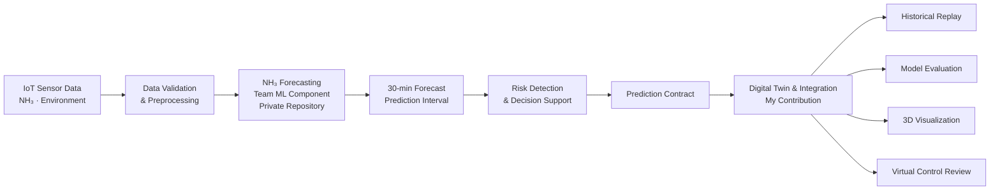
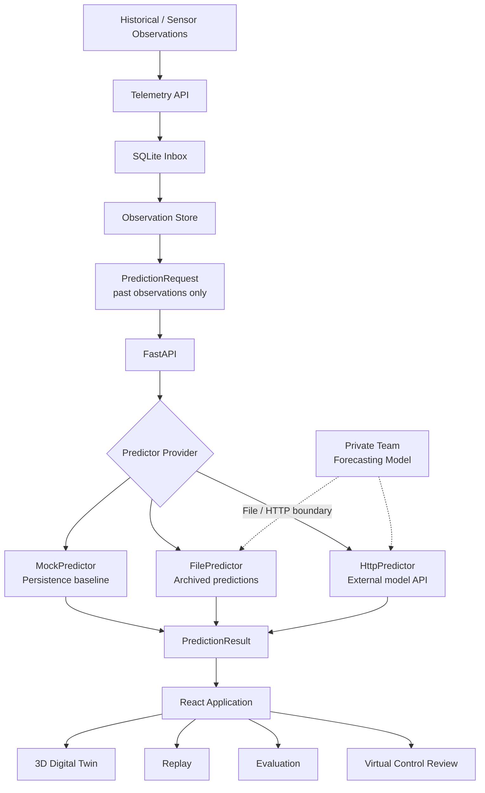

<div align="center">

# Pig Barn Digital Twin 🐷

### Digital Twin & Model Integration for 30-Minute NH₃ Forecasting

**돈사 IoT 관측과 NH₃ 예측 결과를 연결해  
시간 재생 · 모델 비교 · 불확실성 확인 · 3D 시각화를 제공하는  
Digital Twin & Model Integration Layer**

<br/>

[](https://react.dev/)
[](https://threejs.org/)
[](https://fastapi.tiangolo.com/)

[](https://www.python.org/)


<br/>

[▶️ Runbook](RUNBOOK.md)
&nbsp;·&nbsp;
[🔌 Prediction Contract](backend/PREDICTOR_GUIDE.md)
&nbsp;·&nbsp;
[🏢 Original Team Repository](https://github.com/aiot-little-pig/pig-barn-digital-twin)

</div>

---

## 📌 Overview

**아기데지**는 실제 양돈장 IoT 시계열을 기반으로 **30분 후 NH₃ 농도와 고농도 위험을 예측하고, 예측의 불확실성을 함께 전달하여 관리자의 선제 대응을 지원하는 AIoT 팀 프로젝트**입니다.

전체 프로젝트의 중심은 NH₃ forecasting과 reliability evaluation이며, 3D Digital Twin은 모델의 예측을 단순히 시각화하는 데서 끝나지 않고 **예측 당시 이용 가능했던 정보와 이후 실제 관측을 시간순으로 비교하고, 모델 조건과 Prediction Interval을 검토할 수 있는 application layer**로 설계했습니다.

> **Repository Scope**
>
> 이 repository는 4인 팀 프로젝트 중 제가 주로 담당한 **Digital Twin · Model Integration · Replay · Evaluation application layer**를 공개합니다.
>
> NH₃ forecasting 모델의 학습·실험 코드는 다른 팀원이 담당했으며 별도의 private team repository에 유지됩니다. 해당 모델 코드를 이 repository에 복제하거나 개인 구현으로 표현하지 않습니다.

### Project Info

| 항목 | 내용 |
| --- | --- |
| **프로젝트** | 2026 IoT & AI Innovation Challenge · 아기데지 |
| **팀 구성** | 4인 |
| **전체 시스템 목표** | IoT 기반 +30분 NH₃ 예측 · 불확실성 · 고농도 위험 탐지 · 대응 지원 |
| **개인 담당** | Digital Twin · Prediction Integration · Replay · Model Evaluation UI |
| **Frontend** | React 19 · React Three Fiber · Three.js · Vite |
| **Backend** | FastAPI · Pydantic · SQLite · httpx |
| **Data Flow** | JSON / CSV / Telemetry API · File / HTTP Predictor |
| **Evaluation** | MAE · RMSE · R² · Prediction Interval Coverage / Width |
| **Reliability** | 76 Automated Tests · GitHub Actions |

---

## 🧭 Team System Context

이 repository만 보면 프로젝트가 3D visualization 중심으로 보일 수 있지만, 전체 팀 시스템의 흐름은 다음과 같습니다.



### Contribution Boundary

| System Area | Ownership / Repository |
| --- | --- |
| Forecasting model research & training | Team member · private repository |
| Cross-farm / adaptation experiments | Team model component |
| Prediction output | Model component → integration contract |
| Prediction Request / Result contract | **This repository · my implementation** |
| Mock / File / HTTP Predictor abstraction | **This repository · my implementation** |
| Historical Replay | **This repository · my implementation** |
| Model comparison UI | **This repository · my implementation** |
| Telemetry ingestion & local persistence | **This repository · my implementation** |
| React Three Fiber Digital Twin | **This repository · my implementation** |
| Synthetic control scenarios | **This repository · my implementation** |

---

# 🏗️ Architecture



핵심 설계 원칙은 **모델 구현과 application을 분리하는 것**입니다.

Digital Twin은 특정 Ridge, neural network 또는 다른 forecasting implementation을 직접 알지 않습니다.

```text
PredictionRequest
        ↓
Predictor Interface
        ↓
PredictionResult
```

라는 공통 계약만 유지하므로 모델 구현이 바뀌어도 3D application과 Replay/Evaluation layer를 다시 작성할 필요가 없습니다.

---

# 🚀 Engineering Highlights

## 1. Model-independent Prediction Contract

### Problem

팀의 forecasting model과 Digital Twin을 직접 결합하면 모델 형식이 바뀔 때마다 application도 함께 수정해야 합니다.

또한 여러 농장·모델·실험 조건의 prediction을 다루기 때문에 단순히:

```json
{
  "prediction": 18.4
}
```

정도만 전달해서는 어떤 데이터와 모델에서 생성된 값인지 검증하기 어렵습니다.

### Engineering Decision

Pydantic 기반의 명시적인 request / response contract를 정의했습니다.

```text
dataset_id
dataset_version
farm_id
subject_id
condition_id
model_id
model_version
observation_source
unit
issued_at
horizon_minutes
```

를 prediction identity로 함께 전달합니다.

응답에서도 동일 identity와 시간 정보를 검증하여 다른 농장·모델·시점의 prediction이 잘못 연결되는 것을 방지합니다.

```text
issued_at
     +
30 minutes
     =
target_at
```

관계도 contract에서 강제합니다.

### Provider Abstraction

```text
Predictor
├─ MockPredictor
├─ FilePredictor
└─ HttpPredictor
```

로 구현했습니다.

외부 model API가 실패했을 때는 결과를 보기 좋게 만들기 위해 Mock prediction으로 몰래 대체하지 않습니다.

```text
External Model Failure
        ↓
Explicit API Error
        ↓
Frontend Error State
```

를 유지합니다.

---

## 2. 미래 정보를 보지 않는 Historical Replay

Historical dataset은 파일 안에 이미 미래 actual value가 존재할 수 있습니다.

그 데이터를 단순히 화면에 모두 공개하면 Replay 시점에서는 아직 알 수 없어야 할 미래값을 사용하게 되어 실제 prediction 상황을 재현할 수 없습니다.

따라서 Replay clock을 기준으로:

```text
t = 00:00

Available observations
        ↓
Prediction issued for 00:30
        ↓
Future actual hidden
        ↓
Replay reaches 00:30
        ↓
Actual observation revealed
        ↓
Prediction vs Actual comparison
```

순서를 유지합니다.

Prediction request에도 `issued_at` 이후 관측값이 들어가지 않으며, 미래 observation을 직접 전송한 잘못된 request는 backend validation에서 거부됩니다.

되감기를 하더라도 과거에 발행됐던 prediction을 미래 정보를 이용해 다시 계산하지 않습니다.

---

## 3. Fair Model Comparison with a Common Evaluation Cohort

모델 A에는 prediction이 있지만 모델 B에는 없는 timestamp까지 각자 따로 평균을 계산하면 모델 간 비교가 공정하지 않을 수 있습니다.

따라서 선택한 모든 condition이 공통으로 prediction과 actual을 가진 timestamp의 교집합을 사용합니다.

```text
Model A valid samples
         ∩
Model B valid samples
         ↓
Common Point Cohort
         ↓
MAE / RMSE / R²
```

현재 evaluation panel은 다음을 제공합니다.

| Metric | Policy |
| --- | --- |
| **MAE** | common valid timestamps |
| **ΔMAE** | selected baseline 대비 차이 |
| **RMSE** | common valid timestamps |
| **R²** | MAE/RMSE와 동일 cohort |
| **Interval Coverage** | 모든 비교 조건에 interval이 존재하는 common subset |
| **Interval Width** | 동일 interval subset |

R²는:

```text
R² = 1 - SSE / SST
```

로 계산하며, sample이 2개 미만이거나 actual variance가 0이면 결과를 만들지 않습니다.

음수 R²도 숨기지 않고 그대로 표시합니다.

---

## 4. Prediction Interval을 원본 그대로 보존

Forecasting model은 물리적으로 불가능한 음수 prediction이나 interval lower bound를 생성할 수도 있습니다.

이를 application validation 단계에서 0으로 clamp하면 모델의 실제 출력과 한계를 숨기게 됩니다.

따라서:

```text
Observation / Ground Truth
current, actual
→ finite and non-negative

Raw Model Output
prediction, lower, upper
→ any finite number
```

로 구분했습니다.

예:

```text
prediction = 4.2 ppm
lower      = -1.7 ppm
upper      = 10.1 ppm
```

도 raw model output으로는 그대로 유지합니다.

표시 단계에서는 음수 model output을 정상 농도로 포장하지 않고 **원본 확인이 필요한 출력**으로 별도 처리합니다.

---

## 5. IoT Telemetry Intake with Idempotent Persistence

현재 구현은 단순히 frontend에서 JSON fixture를 읽는 구조뿐 아니라 sensor gateway를 연결할 수 있는 local telemetry boundary를 제공합니다.

```text
Sensor / CSV / Mock Sender
        ↓
POST /api/v2/telemetry/observations
        ↓
Validation
        ↓
SQLite Inbox
        ↓
Twin Bundle
        ↓
Replay / Prediction
```

관측 데이터에는:

```text
dataset
dataset version
farm
subject
timestamp
unit
feature metadata
```

를 명시합니다.

같은 timestamp의 동일 observation을 다시 수신하면 중복 저장하지 않고, 같은 timestamp에 다른 값이 들어오면 조용히 overwrite하지 않고 conflict로 처리합니다.

```text
same timestamp + same observation
→ idempotent

same timestamp + conflicting observation
→ reject
```

결측값도 임의로 0이나 보간값으로 바꾸지 않습니다.

---

# 🐷 3D Digital Twin

React Three Fiber와 Three.js로 돈사 내부를 구성하고 관측값과 prediction을 시간축과 공간 표현으로 연결합니다.

Digital Twin 화면에서는:

| 기능 | 역할 |
| --- | --- |
| Current Observation | 현재 Replay 시점의 NH₃ 관측 |
| +30 min Prediction | Predictor가 반환한 예측 |
| Prediction Interval | 제공된 경우 lower / upper 표시 |
| 3D Sensor Position | 농장 / 센서의 위치 표시 |
| Risk View | 제공된 display policy에 따른 상태 표현 |
| Timeline | 관측 · prediction · interval · Replay clock |
| Comparison | target time 도달 후 actual과 prediction 비교 |
| Control Review | 현재/예측 기준의 가상 대응 조건 검토 |

센서 위치나 돈사 치수가 실제 도면으로 검증되지 않은 경우 UI에 **가정된 위치**임을 명시합니다.

농장 전체 대표값을 3D floor에 표시할 때도 실제 spatial distribution이나 CFD 결과인 것처럼 표현하지 않습니다.

---

# 🎛️ Synthetic Control Scenarios

실제 학습 model과 별개로 application 동작과 control logic을 확인하기 위한 deterministic synthetic simulator도 제공합니다.

| Scenario | 의미 |
| --- | --- |
| **C1** | 환기 OFF 가상 통제군 |
| **C2** | 현재 상태 기반 사후 환기 강화 |
| **C3** | **모의 예측 기반** 선제 환기 |
| **C4** | 모의 예측 기반 선제 환기 + 배출측 세정 |

Synthetic simulator는:

```text
dC/dt = source - kC
```

의 단순한 relative concentration model을 사용합니다.

C3/C4에서 사용하는 30분 forecast는 실제 trained AI output이 아니라 **현재 발생 강도가 유지된다고 가정한 deterministic mock forecast**입니다.

따라서 이 시나리오 결과를 실제 AI 성능, 실제 ppm 예측, 실제 환기 효과 또는 CFD 결과로 해석하지 않습니다.

---

# 🔌 Team Forecasting Model Integration

팀의 forecasting model training / experiment implementation은 별도 private repository에 존재합니다.

이 public application은 실제 model과 연결할 수 있도록 다음 두 boundary를 제공합니다.

```text
Model-side Export
      ↓
PredictionArchive
      ↓
FilePredictor
```

또는:

```text
Model Service
      ↓
HTTP Prediction Endpoint
      ↓
HttpPredictor
```

실제 model output에는 최소한 다음 provenance가 필요합니다.

```text
dataset / version
farm / subject
condition
model / version
issued time
target time
unit
prediction
prediction interval metadata
```

현재 보관된 team modeling artifacts에는 aggregate evaluation 결과는 존재하지만, public contract가 요구하는 **timestamp-level prediction output과 고정된 deployment metadata가 완전하게 남아 있지 않아 실제 historical model output의 end-to-end 연결을 완료했다고 주장하지 않습니다.**

즉 현재 상태는:

```text
Prediction Contract       ✅
File / HTTP Boundary      ✅
Synthetic Integration     ✅
Contract Validation       ✅

Actual Historical Team
Model Output E2E          Not claimed
```

입니다.

---

# 🧪 Tests & CI

현재 repository는 **76개의 automated regression test**를 포함합니다.

| Test Suite | Count |
| --- | ---: |
| JavaScript / Node | **55** |
| Python | **21** |
| **Total** | **76** |

주요 검증 범위는 다음과 같습니다.

```text
Prediction identity / timestamps
Future-information blocking
Mock / File / HTTP provider switching
HTTP timeout & invalid response handling
Prediction interval integrity
Raw negative model output preservation
Historical Replay semantics
Common evaluation cohort
MAE / RMSE / R²
Interval coverage / width
Telemetry persistence
Idempotence & conflict detection
Missing-value preservation
Synthetic scenario invariants
Mass-balance checks
```

GitHub Actions에서는 push / pull request마다:

```text
npm ci
npm test
Python unit tests
npm run build
documentation link check
```

를 실행하며 현재 portfolio fork의 `main` workflow도 통과합니다.

---

# 🛠️ Tech Stack

| Category | Technology |
| --- | --- |
| **Frontend** | React 19 · Vite |
| **3D** | React Three Fiber · Three.js · Drei |
| **Backend API** | FastAPI |
| **Contract Validation** | Pydantic |
| **HTTP Integration** | httpx |
| **Local Persistence** | SQLite |
| **Testing** | Node Test Runner · Python unittest |
| **CI** | GitHub Actions |
| **Domain** | IoT · Time-series Forecast Integration · Digital Twin |

---

# 📁 Project Structure

```text
pig-barn-digital-twin/
│
├── src/
│   ├── App.jsx
│   ├── Barn.jsx
│   ├── TwinPanel.jsx
│   ├── ReplayPanel.jsx
│   ├── EvaluationPanel.jsx
│   ├── ControlReview.jsx
│   ├── twinData.js
│   ├── replayData.js
│   └── simulation.js
│
├── backend/
│   ├── app.py
│   ├── schemas.py
│   ├── telemetry.py
│   ├── data_sources/
│   ├── predictors/
│   └── test_*.py
│
├── tests/
│   └── *.test.mjs
│
├── examples/
│   └── *-SYNTHETIC.json
│
├── scripts/
│   ├── local_service.py
│   ├── send_observations.py
│   ├── package_release.py
│   └── check_docs.py
│
├── .github/workflows/ci.yml
├── RUNBOOK.md
├── package.json
└── README.md
```

---

# ▶️ Quick Start

현재 공개 실행 환경은 Windows / Python 3.12 / Node.js 22를 기준으로 검증했습니다.

```powershell
git clone https://github.com/tangerineYR/pig-barn-digital-twin.git
cd pig-barn-digital-twin

.\setup.cmd
.\start.cmd
```

`READY`가 표시되면:

```text
http://127.0.0.1:4173
```

에서 application을 확인할 수 있습니다.

기본 실행은 **synthetic observation + persistence MockPredictor**입니다.

실제 model provider 설정과 상세 실행 절차는 [RUNBOOK.md](RUNBOOK.md) 및 [Prediction Contract Guide](backend/PREDICTOR_GUIDE.md)를 참고하세요.

---

# ✅ Validation

```powershell
npm.cmd test

.\backend\.venv\Scripts\python.exe -m unittest ^
  backend.test_app ^
  backend.test_predictors ^
  backend.test_telemetry

npm.cmd run build

.\backend\.venv\Scripts\python.exe scripts\check_docs.py
```

---

# 🔄 Team Project vs Portfolio Refactoring

이 repository는 원 팀 repository의 **personal portfolio fork**입니다.

Original team repository:

```text
aiot-little-pig/pig-barn-digital-twin
```

Portfolio fork:

```text
tangerineYR/pig-barn-digital-twin
```

팀 프로젝트의 원래 구현과 기여 관계를 유지하면서, 개인 fork에서는 프로젝트 종료 후 공개 포트폴리오 관점의 correctness validation을 추가했습니다.

| Portfolio Refactoring | 내용 |
| --- | --- |
| Synthetic semantics | 실제 AI가 아닌 C3/C4를 `모의 예측 기반`으로 명확화 |
| Evaluation | common cohort 기반 R² 추가 |
| Contract audit | private model artifacts와 public contract gap 검증 |
| Raw output policy | prediction / interval을 임의 clamp하지 않도록 통일 |
| Regression tests | 62 → **76 automated tests** |
| CI | personal fork GitHub Actions 검증 |
| Documentation | 실제 model integration requirements 정리 |

Private model code를 개인 repository로 가져오거나 본인의 구현으로 소급해 표현하지 않았습니다.

---

# ⚠️ Scope & Limitations

**Actual Forecasting Model**

Forecasting model training code는 별도 private team component이며 이 repository에 포함하지 않습니다. 현재 공개 repository에서는 실제 historical team model의 end-to-end 연결 완료를 주장하지 않습니다.

**Synthetic Default**

기본 실행은 synthetic observations와 persistence MockPredictor를 사용합니다. 예제 결과는 실제 모델 성능이 아닙니다.

**3D Geometry**

돈사 치수와 sensor placement 일부는 설계 가정이며 실제 농장 도면을 복제한 것이 아닙니다.

**No CFD**

Floor heatmap은 제공된 값을 시각적으로 표현하는 layer이며 공기 흐름이나 NH₃ spatial dispersion을 계산하는 CFD simulation이 아닙니다.

**No Physical Actuation**

환기팬과 scrubber 판단은 가상 검토 / synthetic scenario입니다. 실제 장치에 command를 전송하지 않습니다.

**No Automatic Live Subscription**

Telemetry endpoint는 데이터를 수신·저장할 수 있지만 frontend는 현재 자동 실시간 subscription이 아니라 명시적으로 데이터를 불러와 Replay하는 방식입니다.

**Event-level Evaluation**

Peak Recall, False Alarm/day, Lead Time은 team experiment 단계에서 운영 event definition이 고정되지 않았기 때문에 public evaluation layer에서 임의로 재정의하지 않았습니다.

---

# 👤 My Contribution

이 프로젝트에서 저는 **Digital Twin 및 application integration 영역을 주도적으로 담당**했습니다.

핵심적으로 구현한 범위는:

```text
React / R3F 3D Digital Twin
        +
Historical Time Replay
        +
Prediction Contract
        +
Mock / File / HTTP Provider
        +
FastAPI Integration
        +
Telemetry Intake & Persistence
        +
Model Evaluation UI
        +
Prediction Interval Visualization
        +
Virtual Control Review
        +
Automated Tests & CI
```

입니다.

팀의 forecasting model 연구 결과를 application에서 어떻게 안전하고 재현 가능하게 소비할 것인지에 초점을 맞추어, **모델과 UI를 직접 결합하지 않고 명시적인 contract와 provider boundary를 두는 구조**로 구현했습니다.

---

# 📚 Project Provenance

Original team repository:

https://github.com/aiot-little-pig/pig-barn-digital-twin

Personal portfolio fork:

https://github.com/tangerineYR/pig-barn-digital-twin

Forecasting model implementation and source datasets are maintained separately and are not redistributed through this repository.

---

<div align="center">

**Forecasting Model → Prediction Contract → Replay → Evaluation → Digital Twin**

_Model performance is only useful when its provenance, timing, uncertainty, and limitations remain visible._

</div>
